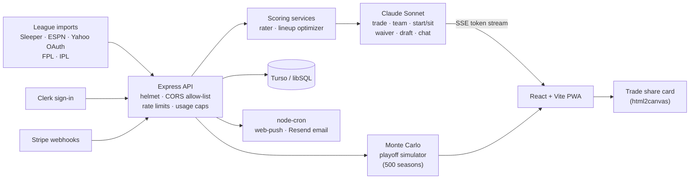

# FantasyRater

**Import your Sleeper, ESPN or Yahoo league and get Claude-powered trade grades, start/sit calls, waiver targets, a draft assistant and a 500-run Monte Carlo playoff predictor, streamed live.**

[](https://github.com/benjaminsinger18-arch/fantasy-rater/actions/workflows/ci.yml)
[](LICENSE)


**Live:** <https://fantasy-rater.vercel.app>. Sign in with Clerk; the free tier includes a few AI calls per feature per day.

## What it does

- **Trade Rater.** Score both sides on rank, recent points and injuries, get a fairness ratio and a verdict from Great Deal to Horrible Deal, then read Claude's reasoning as it streams in. Share the result as an image card.
- **Team Rater, Start/Sit, Waiver Wire, Draft Assistant, Lineup Optimizer, Matchup Analyzer.** The same scoring engine applied to a roster, a lineup decision, the free-agent pool, a live draft, a weekly lineup and a head-to-head.
- **League Predictor.** A 500-run Monte Carlo simulation of the rest of the season gives playoff odds and projected seeds.
- **Live Scoring and Player Rankings** for the current week.
- **Fantasy Chat.** Ask anything with your league loaded as context.
- **Alerts.** Injury push notifications every 15 minutes and a Monday email digest.
- **Multi-sport.** NFL (Sleeper, ESPN, Yahoo), MLB, Fantasy Premier League and IPL cricket.
- **Installable PWA** on desktop and phone, plus an Expo mobile app.

## How it works



A rating request is scored by pure TypeScript first, so the verdict appears instantly. The prompt for the written analysis is sanitized, hashed and queued, and the client opens a server-sent events stream that renders each Claude token as it arrives. Everything that costs money sits behind Clerk auth and a per-feature daily cap for free users.

## Tech stack

| Layer | Choice | Why |
| --- | --- | --- |
| Client | React 18, Vite 5, TypeScript, Tailwind 3, Framer Motion | Fast lazy-loaded routes with page transitions; installable through `vite-plugin-pwa` |
| Auth | Clerk | Hosted sign-in on web and mobile, verified server-side with `@clerk/backend` |
| API | Express 4, TypeScript (ESM), Node 20 | One codebase runs as a Vercel function and a long-lived Railway process |
| AI | Anthropic SDK, Claude Sonnet | Streams analysis token by token over SSE |
| Data | Turso (libSQL) | Serverless SQLite with a local file fallback in development |
| Billing | Stripe Checkout and signature-verified webhooks | Free vs. Pro tiers enforced per feature per day |
| Alerts | node-cron, web-push, Resend | Injury alerts every 15 minutes, weekly digest on Mondays |
| Mobile | Expo 52, Expo Router 4, React Native 0.76 | Same API, native notifications |

## Quickstart

```bash
git clone https://github.com/benjaminsinger18-arch/fantasy-rater.git
cd fantasy-rater && npm run install:all
cp server/.env.example server/.env && cp client/.env.example client/.env   # add Anthropic + Clerk keys
npm run dev          # server :3001, client :5173 (Windows cmd: run dev:server and dev:client separately)
```

Every variable, the Vercel and Railway layout, the Stripe webhook and Yahoo OAuth are in [docs/SETUP.md](docs/SETUP.md).

## Engineering highlights

- **Streaming analysis over SSE** with the prompt hashed and queued server-side, so the slow part (Claude) never blocks the verdict and the UI renders incrementally.
- **Security defaults on a paid API.** `helmet`, an explicit CORS allow-list, global and per-route rate limits, a 1 MB body cap, Clerk token verification on every feature route, and prompt-input sanitization before any user text reaches the model.
- **Usage caps as middleware.** `checkUsage(feature, n)` returns HTTP 402 when a free user is over their daily count; Pro status comes from Stripe through signature-verified webhooks mounted ahead of the JSON parser.
- **Monte Carlo playoff odds.** 500 simulated seasons with Gaussian scoring noise, in a pure function that is trivial to test.
- **Five platform adapters** map Sleeper, ESPN, Yahoo, FPL and IPL into one `Player` and `League` shape, so every feature is platform-agnostic.
- **One Express app, two runtimes.** A one-line adapter in `api/[...path].ts` exports the app as a Vercel function; Railway runs the same app for cron and SSE.
- **Typecheck and build in CI** for both workspaces on every push.

## Roadmap

- Unit tests for the rater, lineup optimizer and playoff simulator.
- NBA support in the client (the server already accepts it).
- Persist chat history per league.
- Replace the shared-secret mobile config with per-user API keys.

## Docs

- [Setup](docs/SETUP.md): run locally, environment variables, Vercel, Railway, Stripe, Yahoo
- [Architecture](docs/ARCHITECTURE.md): request path, routers, streaming, simulation, data, cron, platforms
- [Mobile app](mobile/README.md)

## License

MIT, Benjamin Singer. See [LICENSE](LICENSE).
